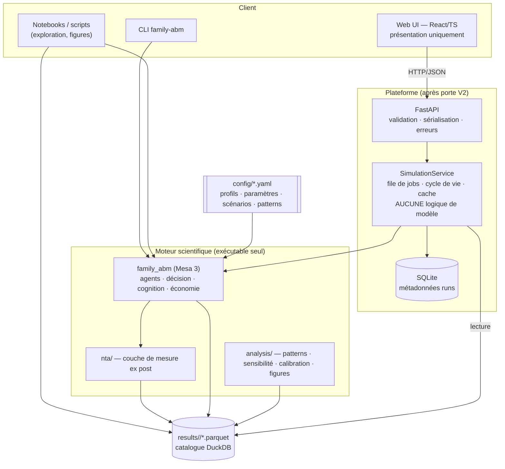

# 01 — Architecture du système

> Ce document fixe la structure du dépôt, les couches, les règles de dépendance, l'ordonnancement d'un pas de temps et les boucles de rétroaction. Les noms de modules, classes et fichiers définis ici sont **normatifs** : les autres specs les réutilisent tels quels.

---

## 1. Vue d'ensemble (C4 — niveau conteneurs)



**Règle de survie :** `family_abm` (Coeur) n'importe jamais `family_abm_api` ni quoi que ce soit du serveur. Il s'exécute par `python -m family_abm run --scenario baseline --seed 42`.

## 2. Structure du dépôt (normative)

```
family_abm/                              ← racine du dépôt
├── CLAUDE.md                            ← règles pour Claude Code (copié depuis specs/)
├── pyproject.toml                       ← uv ; paquets family_abm et family_abm_api ; script console
│                                           `family-abm = "family_abm.__main__:app"` (les deux formes
│                                           `uv run family-abm …` et `uv run python -m family_abm …` sont valides)
├── specs/                               ← CE dossier de spécifications (lecture seule pour Claude Code)
├── odd/                                 ← ODD versionné avec le code
│   ├── ODD_v0_conceptual.md
│   ├── ODD_v1_economic.md
│   ├── ODD_v2_cognitive.md
│   └── ODD_v3_affective_population.md
├── docs/
│   ├── DECISIONS.md                     ← journal des décisions (copie vivante de specs/00)
│   ├── MATRICE_QUESTION_MODELE.md
│   ├── FICHES_CONCEPTION.md
│   └── GATES.md                         ← état des portes V1/V2/V3 (cases cochées par les tests)
├── config/
│   ├── simulation.yaml                  ← horizon, version, bascules, seeds
│   ├── cognitive_profiles.yaml          ← 6 profils (bébé → parent)
│   ├── economic_params.yaml             ← prix, revenus, taux, profils de consommation par âge
│   ├── needs.yaml                       ← besoins, décroissance, seuils, coût par âge
│   ├── household_rules.yaml             ← allocation, poids, propriété du pot commun, crédit
│   ├── plans.yaml                       ← bibliothèque de plans [V2]
│   ├── affect.yaml                      ← appraisal, émotions, modulation [V3]
│   ├── calibration.yaml                 ← campagne de calibration : grille/LHS, réplications, tolérances [V3] (40 §6)
│   ├── risk.yaml                        ← CPT [V3]
│   ├── population.yaml                  ← générateur de population [V3]
│   ├── patterns.yaml                    ← P1–P7, rôle calibration/validation FIGÉ + hash
│   ├── parameters_registry.yaml         ← registre des paramètres : bornes, traitement (§13.6)
│   ├── scenarios/                       ← baseline, job_loss, illness, family_allowance, free_care, economic_shock
│   └── experiments/                     ← E1.yaml … E9.yaml, E_SA.yaml
├── data/
│   ├── raw/                             ← jamais commité (EHCVM, NTA)
│   ├── processed/                       ← cibles et distributions dérivées (commitées si non sensibles)
│   └── README.md                        ← provenance, licence, procédure d'accès
├── src/family_abm/
│   ├── __main__.py                      ← CLI (Typer)
│   ├── api_entry.py                     ← run_simulation(config, out_dir, on_year_end=None) : seul point d'entrée
│   │                                       du moteur exposé à l'API ; on_year_end = simple callable optionnel
│   │                                       (annulation/progression), aucune dépendance web (60_SPEC_API)
│   ├── config/
│   │   ├── schemas.py                   ← modèles Pydantic de toute la configuration
│   │   └── loader.py                    ← chargement + validation + empreinte de config
│   ├── core/
│   │   ├── types.py                     ← enums, alias (Money, AgentId, Step…)
│   │   ├── rng.py                       ← RngStreams (SeedSequence → sous-flux nommés)
│   │   └── errors.py                    ← InvariantViolation, ConfigError, LedgerError, NotInV1Error,
│   │                                       CalibrationLeakError, TreatmentCalibrationError
│   │                                       (l'absence de plan applicable est un ÉVÉNEMENT, pas une exception)
│   ├── agents/
│   │   ├── person.py                    ← PersonAgent — coquille mince, aucune logique métier
│   │   ├── household.py                 ← HouseholdAgent — collecte, allocation, dette, régimes
│   │   ├── allocation.py                ← allocate(): fonction pure paramétrée (S1)
│   │   └── states.py                    ← EconomicState, PhysicalState, NeedsState, CognitiveState, AffectiveState
│   ├── decision/                        ← LE point de variation polymorphe
│   │   ├── engine.py                    ← Protocol DecisionEngine ; Percept, DecisionTrace
│   │   ├── alternatives.py              ← génération des alternatives selon capacités
│   │   ├── satisficing.py               ← SatisficingEngine (couvre réactif → délibératif)
│   │   ├── discounting.py               ← β-δ [V2 optionnel]
│   │   ├── plans.py                     ← PlanLibrary, Intention, replanification [V2]
│   │   └── risk.py                      ← CPT sur 4 décisions binaires [V3]
│   ├── cognition/
│   │   ├── memory.py                    ← MemoryService (transversal) [V2]
│   │   ├── beliefs.py                   ← révision des croyances [V2]
│   │   ├── aspiration.py                ← adaptation du seuil d'aspiration [V2]
│   │   ├── appraisal.py                 ← AppraisalEngine [V3]
│   │   └── modulation.py                ← ModulationEngine → EffectiveCognitiveProfile [V3]
│   ├── economy/
│   │   ├── accounts.py                  ← AccountId, comptes internes/externes
│   │   ├── ledger.py                    ← Ledger double entrée — source unique de vérité
│   │   ├── actions.py                   ← exécution des actions → écritures Ledger
│   │   ├── labor.py                     ← revenu du travail, emploi, chocs de revenu
│   │   ├── credit.py                    ← dette, intérêts, plafond de crédit
│   │   ├── prices.py                    ← prix, inflation (scénarios)
│   │   └── public.py                    ← transferts publics, Cg, scénarios de politique
│   ├── health/
│   │   └── health.py                    ← transitions de santé, capacité de travail
│   ├── nta/
│   │   ├── ntta.py                      ← NTTA optionnel : temps domestique valorisé, comptes séparés [V2]
│   │   ├── accounts.py                  ← NTACalculator : LCD, τ⁺/τ⁻, Ya, S, par personne et par pas
│   │   ├── attribution.py               ← règle d'attribution du pot commun (propriété ω)
│   │   ├── imputation.py                ← règle du manuel ONU (chef de ménage) — JAMAIS fusionné avec accounts.py
│   │   ├── profiles.py                  ← agrégation par âge (profils NTA)
│   │   └── invariants.py                ← tests de bouclage — lèvent InvariantViolation
│   ├── population/
│   │   ├── generator.py                 ← population synthétique [V3]
│   │   ├── sources.py                   ← DataSource : synthetic / nta_profiles / ehcvm (40 §4)
│   │   └── prepare.py                   ← python -m family_abm.population.prepare {nta|ehcvm} → data/processed/
│   ├── model/
│   │   ├── family_model.py              ← FamilyModel(mesa.Model) — ordonnancement en 3 temps
│   │   ├── scheduler.py                 ← les 3 temps, explicitement nommés
│   │   ├── events.py                    ← chocs exogènes (scénarios) et journal d'événements
│   │   └── collectors.py                ← collecte → tables Parquet (04_DATA_MODEL)
│   ├── io/
│   │   ├── parquet.py                   ← écriture partitionnée, schémas Arrow
│   │   └── catalog.py                   ← catalogue DuckDB des runs
│   └── analysis/
│       ├── indicators.py                ← indicateurs du tableau de bord (DOC §6)
│       ├── patterns.py                  ← calcul des patterns POM P1–P7
│       ├── sensitivity.py               ← SALib : Morris puis Sobol
│       ├── calibration.py               ← CalibrationEngine (grille) [V3]
│       ├── efficiency.py                ← repère d'efficacité collective (E8) [V3]
│       ├── experiments.py               ← ExperimentRunner générique (lit config/experiments)
│       └── figures.py                   ← toutes les figures du mémoire, reproductibles
│   └── viz/
│       └── solara_app.py                ← démonstrateur léger optionnel (Q8, 70 §Solara) — n'importe que io/ et analysis/
├── scripts/
│   ├── gate.py                          ← portes V1/V2/V3 → docs/GATES.md (90 §3)
│   └── profile_run.py                   ← profilage cProfile/pyinstrument (30 §11)
├── src/family_abm_api/                  ← [après porte V2] voir 60_SPEC_API.md
├── web/                                 ← [après porte V2] voir 70_SPEC_UX_UI.md
├── tests/
│   ├── unit/ … integration/ … invariants/ … architecture/ … performance/
│   └── conftest.py
├── experiments/results/                 ← Parquet, jamais commités (.gitignore)
└── notebooks/                           ← exploration uniquement, aucune logique
```

## 3. Couches et règles de dépendance

Les dépendances vont **vers le bas uniquement**. Elles sont vérifiées par `import-linter` (contrats dans `pyproject.toml`) et un test `tests/architecture/test_layers.py`.

```
 analysis/   population/   model/
     │            │          │
     ▼            ▼          ▼
   nta/  ◄──────────────── (model/ appelle nta/ en fin de Temps 3 — lecture seule)
     │
     ▼
 agents/ ──► decision/ ──► cognition/
     │           │             │
     ▼           ▼             ▼
 economy/    health/       core/, config/
```

| Contrat | Règle |
|---|---|
| C1 — NTA en lecture seule | `agents`, `decision`, `cognition`, `economy`, `health` **ne doivent pas** importer `family_abm.nta` ni `family_abm.analysis`. |
| C2 — Moteur indépendant | `family_abm` ne doit pas importer `family_abm_api`, `fastapi`, `sqlalchemy`, `sqlmodel`. |
| C3 — Imputation séparée | `nta.accounts` ne doit pas importer `nta.imputation` et réciproquement. |
| C4 — Décision ne lit pas l'affect | `decision` ne doit pas importer `cognition.appraisal` ; elle reçoit un `EffectiveCognitiveProfile` déjà modulé. |
| C5 — Pas d'état global | Aucun singleton, aucune variable de module mutable ; tout passe par le `FamilyModel`. |

## 4. Ordonnancement d'un pas de temps (mensuel) — les trois temps

C'est la correction n°4 de l'audit (feuille de route §7). L'ordre est **normatif** et documenté dans la section « Process overview and scheduling » de chaque ODD.

```mermaid
sequenceDiagram
  autonumber
  participant M as FamilyModel
  participant E as Environment/Events
  participant P as PersonAgent (×n, ordre aléatoire seedé)
  participant H as HouseholdAgent
  participant L as Ledger
  participant N as NTACalculator + Invariants
  participant C as Collectors

  M->>E: 0. avancer l'horloge, appliquer les chocs exogènes du pas (scénario)
  Note over M,P: TEMPS 1 — perception & demande
  M->>P: perceive(env, household_view)
  P->>P: remise à zéro des dépenses du pas, santé (épisodes), perception de l'état
  P->>P: [V2] encoder les épisodes perçus ; réviser croyances, dériver désirs (mémoire lue)
  P->>P: [V3] appraisal → affect (émotions, stress) → modulation → EffectiveCognitiveProfile
  P->>P: [V2] délibération : adopter / garder / reconsidérer l'intention (lit le profil effectif)
  P->>P: [V3] CPT si une décision binaire est ouverte
  P->>P: DecisionEngine.decide() (satisficing) → DemandSet priorisé + DecisionTrace
  P->>H: soumettre DemandSet
  Note over M,H: TEMPS 2 — arbitrage du foyer
  M->>H: emploi, revenu du travail, impôts ; transferts publics ; intérêts ⇒ écritures Ledger
  H->>H: [V3] test de régime (sphères séparées) — avant la mise en commun
  H->>H: mise en commun (POOLING) ⇒ écritures Ledger
  H->>H: engagements obligatoires (logement, échéance de la dette)
  H->>H: allocate(demands, budget, règle paramétrée) → AllocationSet
  H->>L: emprunter si nécessaire (désépargne) — écritures
  H->>P: notifier les allocations (accordé / partiel / refusé)
  Note over M,N: TEMPS 3 — action & comptabilité
  M->>P: act(allocation) — consommer, se soigner, étudier, épargner…
  P->>L: écritures (consommation, transferts)
  P->>P: mise à jour des niveaux de besoins (lissage) après les actions
  P->>P: [V2] évaluer le résultat → mémoire, aspiration, avancement du plan
  M->>N: compute(step) depuis le Ledger
  N->>N: vérifier invariants — échec dur (InvariantViolation)
  M->>C: collecter les tables du pas
  M->>M: vieillir (age_months += 1, transitions de profil) APRÈS la collecte ; [V2] départ éventuel du foyer ; avancer step
```

**Points d'ordonnancement explicites :**

1. **Revenu du travail** : versé au début du Temps 2 (le salaire du mois finance les dépenses du mois). Le travail effectué est celui décidé au pas précédent (`labor_supply` persistant) ; en V1, constant sauf choc.
2. **Ordre des personnes** au Temps 1 : aléatoire seedé (`rng.scheduling`), sans effet sur le résultat en V1–V2 (les demandes sont collectées puis arbitrées simultanément). Test : permuter l'ordre ne change pas les allocations.
3. **Le foyer agit une seule fois par pas**, entre les deux phases des personnes.
4. **Les invariants sont vérifiés à chaque pas** (pas seulement en fin de run). Pour les campagnes de sensibilité et de population, et **seulement après** que la porte V1 est verte, `checks.invariant_run_sample_rate` (< 1) fixe la fraction des runs vérifiés à chaque pas ; les autres runs restent vérifiés tous les `checks.invariant_period_unsampled` pas (défaut 12). Les invariants ne sont jamais totalement désactivés (03 §2).
5. **Population (V3)** : les foyers sont indépendants (aucune interaction inter-foyers dans le périmètre). Le pas exécute les 3 temps foyer par foyer ; parallélisable sans effet sur le résultat.

## 5. Les trois boucles de rétroaction (nommées)

| Boucle | Chemin (modules) | Question | Version | Expérience |
|---|---|---|---|---|
| **B1 — économique** | `economy.actions` → `EconomicState` → `NeedsState` → `decision` → demandes → `allocation` | La contrainte budgétaire suffit-elle à produire les trajectoires de dette ? | V1 | E1 |
| **B2 — cognitive** | résultat d'action → `cognition.memory` → `cognition.aspiration` → `decision` | L'adaptation des aspirations produit-elle un ajustement réaliste au choc ? | V2 | E2, E3 |
| **B3 — affective** | contrainte → `cognition.appraisal` → `AffectiveState` → `cognition.modulation` → `EffectiveCognitiveProfile` → `decision` → contrainte | Cette boucle peut-elle produire un enfermement endogène ? 【HYP】 | V3 | E4 |

Chaque boucle est **désactivable** par configuration (`loops.b2.enabled`, `loops.b3.enabled`) — c'est ce qui rend E2 et E4 possibles à seed identique.

## 6. La mémoire, service transversal (V2+)

`MemoryService` n'est pas une étape du pipeline. Interface :

| Lecteur / écrivain | Opération | Usage |
|---|---|---|
| Perception (Temps 1) | `recall(cue)` | reconnaître une situation déjà vécue (croyance `income_stable`) |
| Point de référence (V3, CPT) | `reference_level(kind)` | niveau de consommation de référence = moyenne pondérée par activation |
| Aspiration (Temps 3) | `recent_outcomes(goal, k)` | succès/échecs récents pour adapter θ |
| Sélection de plan (Temps 3) | `plan_history(plan_id)` | éviter un plan récemment échoué |
| Action, appraisal | `encode(episode)` | écrire un épisode |

## 7. Flux aléatoires (S4)

```python
class RngStreams:
    """Un SeedSequence racine → sous-générateurs nommés, stables."""
    NAMES = ("scheduling", "income_shocks", "employment", "health",
             "prices", "memory_noise", "population", "decision_ties",
             "tontine")                    # tontine : mois de la cagnotte tiré (V3, 30 §7)
    def __init__(self, seed: int): ...
    def __getitem__(self, name: str) -> np.random.Generator: ...
```

- Chaque `HouseholdAgent` reçoit ses propres sous-flux dérivés de `(seed, household_index)` → un foyer donne la même trajectoire qu'il soit simulé seul ou dans une population de 1 000 (test `test_household_independence`).
- Mesa 3 : passer `rng`/`seed` au `mesa.Model` pour son propre usage, mais **aucune logique ne tire dans `model.random`** ; tout passe par `RngStreams`.

## 8. Budgets de performance (mesurés par `tests/performance/`)

| Mesure | V1 | V2 | V3 |
|---|---|---|---|
| 1 foyer × 240 pas | < 5 s | < 15 s | < 20 s |
| 1 000 foyers × 240 pas, 1 cœur | — | — | < 10 min (cible) |
| 100 réplications × 1 000 foyers | — | — | parallélisables (`joblib`, 1 processus par réplication) |

Principales leviers si dépassement : invariants échantillonnés, collecte agrégée (pas de `decision_trace` détaillée hors foyers échantillonnés), `__slots__` sur les états, éviter pandas dans la boucle (listes → Arrow en fin de bloc).
