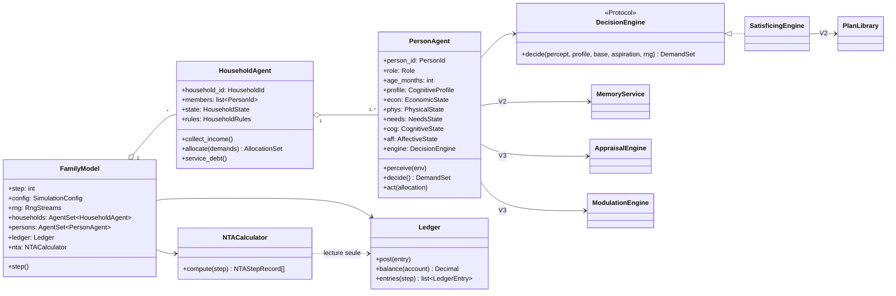
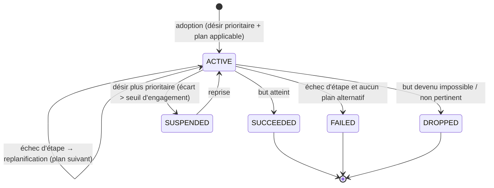
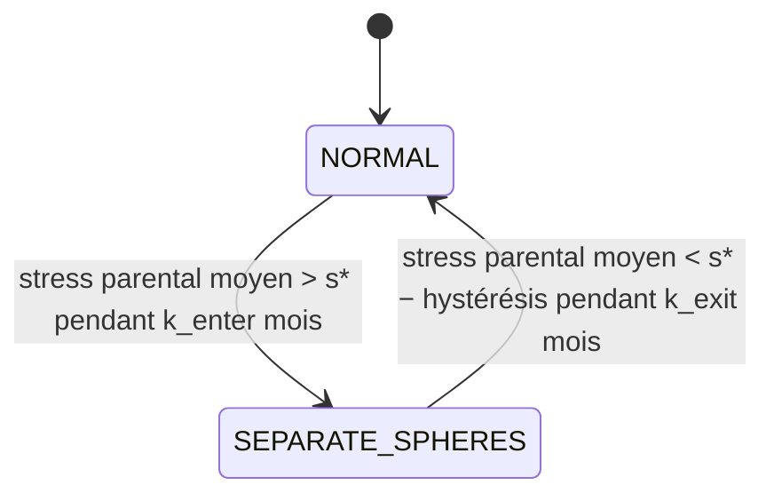
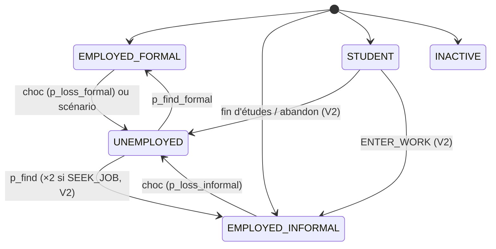
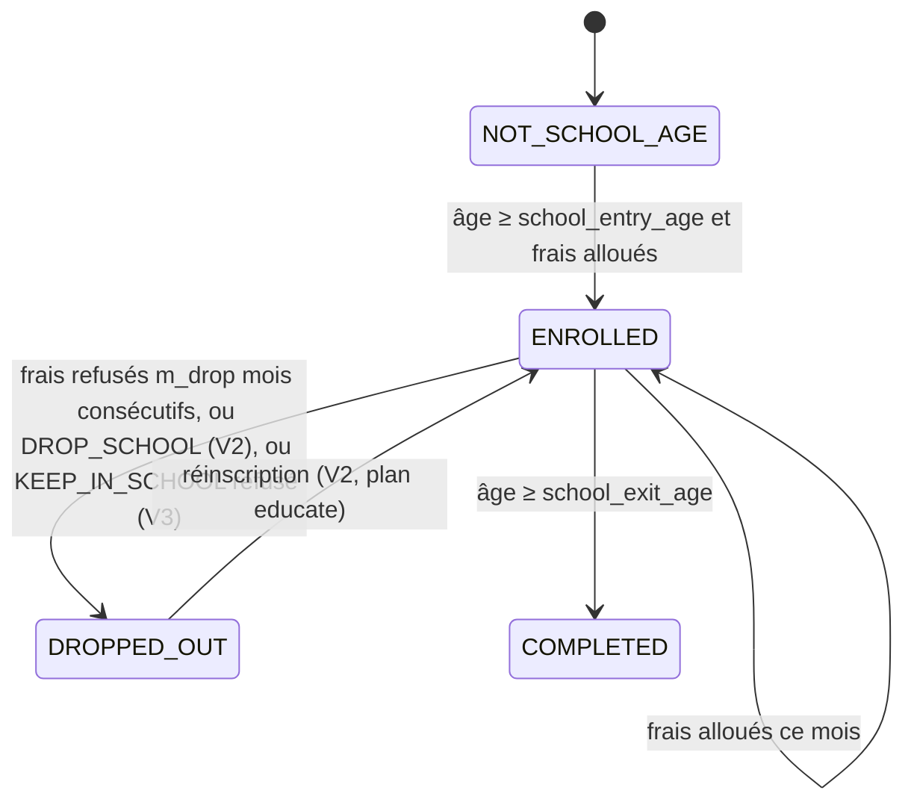

# 02 — Modèle de domaine

> Entités, états, objets-valeurs, énumérations, comptes et règles comptables. Les noms sont **normatifs**. La colonne « V » indique la version où un champ devient actif ; un champ d'une version ultérieure **existe** dès la V1 avec sa valeur neutre (documentée), afin d'éviter les migrations de schéma.

---

## 1. Diagramme de classes



Signature normative (alignée sur `10_SPEC_V1` §7.1) : `decide(percept: Percept, profile: EffectiveCognitiveProfile, base: CognitiveProfile, aspiration: Mapping[NeedKind, float], rng: np.random.Generator) -> DemandSet`. `SatisficingEngine` est **la seule** implémentation de `DecisionEngine` livrée. Le `Protocol` existe pour les tests (moteur scripté `ScriptedEngine` dans `tests/`) et pour les extensions futures (RL, Chap. 9).

## 2. Énumérations (`core/types.py`)

```python
class Role(StrEnum):             # ÉTIQUETTE DESCRIPTIVE UNIQUEMENT — jamais testée dans la logique (D1)
    FATHER = "father"; MOTHER = "mother"; YOUNG_ADULT = "young_adult"
    ADOLESCENT = "adolescent"; CHILD = "child"; BABY = "baby"

class Capability(StrEnum):       # ce que le profil autorise ; seule source de variation de comportement avec les paramètres
    WORK = "work"; CONSUME = "consume"; SAVE = "save"; SEEK_CARE = "seek_care"
    STUDY = "study"; REST = "rest"
    BORROW_REQUEST = "borrow_request"      # V2 — peut demander un emprunt au foyer
    SEEK_JOB = "seek_job"                  # V2
    PLAN = "plan"                          # V2 — accès à la PlanLibrary
    REMEMBER = "remember"                  # V2 — accès en écriture à la mémoire épisodique
    APPRAISE = "appraise"                  # V3
    RISK_EVAL = "risk_eval"                # V3 — CPT sur décisions binaires
    LEAVE_HOUSEHOLD = "leave_household"    # V2, si household_rules.young_adult_can_leave

class NeedKind(StrEnum):
    FOOD = "food"; HEALTH = "health"; EDUCATION = "education"
    HOUSING = "housing"; REST = "rest"; SECURITY = "security"

class Tier(IntEnum):              # ordre d'arbitrage du foyer
    COMMITMENT = 0   # service de la dette, loyer — prélevé avant toute demande
    ESSENTIAL = 1    # alimentation, soins urgents
    EDUCATION = 2
    OTHER = 3        # repos/loisirs, soins non urgents
    SAVING = 4

class ActionKind(StrEnum):
    WORK = "work"; CONSUME = "consume"; SAVE = "save"; SEEK_CARE = "seek_care"
    STUDY = "study"; REST = "rest"
    # V2
    SEEK_JOB = "seek_job"; INCREASE_LABOR = "increase_labor"; REDUCE_CONSUMPTION = "reduce_consumption"
    REQUEST_BORROW = "request_borrow"; REPAY_EXTRA = "repay_extra"; WITHDRAW_SAVINGS = "withdraw_savings"
    CONTRIBUTE_MORE = "contribute_more"; LEAVE_HOUSEHOLD = "leave_household"
    DROP_SCHOOL = "drop_school"; ENTER_WORK = "enter_work"
    # V3 — décisions binaires évaluées par CPT
    TAKE_LOAN = "take_loan"; JOIN_MUTUELLE = "join_mutuelle"
    KEEP_IN_SCHOOL = "keep_in_school"; JOIN_TONTINE = "join_tontine"

class EmploymentStatus(StrEnum):
    EMPLOYED_FORMAL = "employed_formal"; EMPLOYED_INFORMAL = "employed_informal"
    UNEMPLOYED = "unemployed"; STUDENT = "student"; INACTIVE = "inactive"

class SchoolStatus(StrEnum):
    NOT_SCHOOL_AGE = "not_school_age"; ENROLLED = "enrolled"; DROPPED_OUT = "dropped_out"; COMPLETED = "completed"

class DemandStatus(StrEnum):
    GRANTED = "granted"; PARTIAL = "partial"; REFUSED = "refused"

class HouseholdRegime(StrEnum):
    NORMAL = "normal"; SEPARATE_SPHERES = "separate_spheres"   # V3

class AllocationMode(StrEnum):    # paramètre d'UNE fonction allocate(), pas des classes (S1)
    UNITARY = "unitary"; FIXED_WEIGHTS = "fixed_weights"; VARIABLE_WEIGHTS = "variable_weights"

class IntentionStatus(StrEnum):
    ACTIVE = "active"; SUCCEEDED = "succeeded"; FAILED = "failed"; DROPPED = "dropped"; SUSPENDED = "suspended"

class Emotion(StrEnum):           # V3 — 4 émotions + stress et humeur portés à part
    JOY = "joy"; SADNESS = "sadness"; FEAR = "fear"; ANGER = "anger"

class DiscountingMode(StrEnum):
    NONE = "none"; EXPONENTIAL = "exponential"; NAIVE_BETA_DELTA = "naive"; SOPHISTICATED_BETA_DELTA = "sophisticated"
```

## 3. Objets-valeurs et identifiants

| Type | Définition |
|---|---|
| `Money` | `Decimal` quantifié à `0.01` (Ledger) ; `float` dans les tables d'analyse |
| `Step` | `int ≥ 0`, mois écoulés depuis t₀ |
| `PersonId` | `str` — `"{household_id}-p{index}"`, ex. `"h0007-p3"` |
| `HouseholdId` | `str` — `"h{index:04d}"` |
| `AccountId` | `NamedTuple(kind: AccountKind, owner: str \| None)` |
| `RunId` | `str` — ULID |
| `ConfigHash` | `str` — SHA-256 de la configuration résolue (canonique JSON) |

## 4. États (`agents/states.py`)

Tous les états sont des `@dataclass(slots=True)` **mutables mais passifs** : aucune méthode métier, seulement des accesseurs. La logique vit dans `economy/`, `health/`, `cognition/`, `decision/`.

### 4.0 Attributs d'identité et de parcours portés par `PersonAgent`

| Champ | Type | V | Description |
|---|---|---|---|
| `person_id`, `household_id` | str | V1 | identifiants |
| `role` | `Role` | V1 | étiquette descriptive, jamais testée dans la logique (D1) |
| `profile_key` | str | V1 | clé du profil courant dans `cognitive_profiles.yaml` ; change par `profile_transitions` |
| `age_months` | int | V1 | âge en mois |
| `school_status` | `SchoolStatus` | V1 | machine à états §10.4 |
| `refused_edu_months` | int | V1 | mois consécutifs de frais d'éducation refusés (déclenche `DROPPED_OUT`) |
| `in_household` | bool | V2 | faux après départ du foyer (D13) |

### 4.1 `EconomicState` (par personne)

| Champ | Type | Domaine | V | Description |
|---|---|---|---|---|
| `employment` | `EmploymentStatus` | — | V1 | statut d'emploi |
| `wage_monthly` | `Money` | ≥ 0 | V1 | salaire mensuel à plein temps |
| `labor_supply` | `float` | [0, 1.25] | V1 | fraction de temps plein (>1 = heures sup., V2) |
| `pooling_rate` | `float` | [0, 1] | V1 | part du revenu versée au pot commun (profil + règles) |
| `wallet_cached` | `Money` | — | V1 | solde du compte personnel, **cache** du Ledger (invariant : égal au Ledger) |
| `spent_by_need` | `dict[NeedKind, Money]` | ≥ 0 | V1 | dépenses du pas, remis à zéro au Temps 1 |
| `months_unemployed` | `int` | ≥ 0 | V1 | |
| `months_employed` | `int` | ≥ 0 | V1 | mois consécutifs en emploi (sert `can_leave`, V2) |
| `in_mutuelle` | `bool` | — | V3 | adhérent mutuelle de santé (neutre : `False`) |
| `in_tontine` | `bool` | — | V3 | (neutre : `False`) |

### 4.2 `PhysicalState`

| Champ | Type | Domaine | V | Description |
|---|---|---|---|---|
| `health` | `float` | [0, 1] | V1 | 1 = pleine santé |
| `sick` | `bool` | — | V1 | épisode de maladie en cours |
| `care_need` | `Money` | ≥ 0 | V1 | coût des soins requis ce pas |
| `labor_capacity` | `float` | [0, 1] | V1 | `= clip((health − h_min)/(1 − h_min), 0, 1)` |
| `fatigue` | `float` | [0, 1] | V2 | augmente avec `labor_supply > 1`, diminue avec REST |

### 4.3 `NeedsState`

| Champ | Type | Domaine | V | Description |
|---|---|---|---|---|
| `level` | `dict[NeedKind, float]` | [0, 1] | V1 | niveau lissé du besoin (1 = pleinement satisfait) |
| `satisfaction` | `dict[NeedKind, float]` | [0, 1] | V1 | satisfaction instantanée du pas |
| `active` | `frozenset[NeedKind]` | — | V1 | besoins pertinents pour la personne (ex. pas d'EDUCATION pour le bébé) |

### 4.4 `CognitiveState` (V2 ; neutre en V1)

| Champ | Type | V | Neutre V1 | Description |
|---|---|---|---|---|
| `beliefs` | `dict[str, Belief]` | V2 | `{}` | prédicats + confiance (voir §6) |
| `desires` | `list[Desire]` | V2 | `[]` | buts priorisés |
| `intention` | `Intention \| None` | V2 | `None` | intention en cours (une seule active ; pile de sous-buts dans le plan) |
| `aspiration` | `dict[NeedKind, float]` | V1 | `profile.aspiration_init` | seuils θₖ ; **fixes en V1**, adaptatifs en V2 |
| `failure_streak` | `dict[NeedKind, int]` | V2 | `0` | |

### 4.5 `AffectiveState` (V3 ; neutre avant)

| Champ | Type | Domaine | Neutre | Description |
|---|---|---|---|---|
| `emotions` | `dict[Emotion, float]` | [0, 1] | 0 | intensités |
| `stress` | `float` | [0, 1] | 0 | accumulateur |
| `mood` | `float` | [−1, 1] | 0 | moyenne mobile exponentielle de la valence |

### 4.6 `HouseholdState`

| Champ | Type | V | Description |
|---|---|---|---|
| `regime` | `HouseholdRegime` | V3 | neutre `NORMAL` |
| `weights` | `dict[PersonId, float]` | V1 | poids d'allocation (somme = 1) ; fixes V1, variables V2 si `VARIABLE_WEIGHTS` |
| `ownership` | `dict[PersonId, float]` | V1 | parts ω de propriété du pot commun (somme = 1) |
| `head_id` | `PersonId` | V1 | chef de ménage **pour l'imputation ONU uniquement** |
| `credit_limit` | `Money` | V1 | `= κ × revenu mensuel du foyer (moyenne glissante 12 mois)` |
| `arrears_months` | `int` | V1 | mois consécutifs d'échéance non honorée |
| `stress_months` | `int` | V3 | mois consécutifs où le stress parental moyen > s* |
| `cached_pot`, `cached_savings`, `cached_loan` | `Money` | V1 | caches du Ledger (invariant) |

## 5. Demandes et allocations (Temps 1 → Temps 2)

```python
@dataclass(frozen=True, slots=True)
class Demand:
    demand_id: str                 # f"{step}-{person_id}-{k}"
    person_id: PersonId
    need: NeedKind | None          # None pour SAVING
    tier: Tier
    amount_requested: Money        # ce que la personne voudrait
    amount_min: Money              # en deçà, la demande est inutile (ex. frais de scolarité indivisibles)
    priority: int                  # rang intra-personne (0 = le plus urgent)
    divisible: bool                # False ⇒ tout ou rien (scolarité, soin d'un épisode)
    plan_id: str | None = None     # V2 — demande issue d'un plan
    action: ActionKind = ActionKind.CONSUME

@dataclass(frozen=True, slots=True)
class DemandSet:
    person_id: PersonId
    demands: tuple[Demand, ...]
    labor_supply: float            # offre de travail décidée pour le pas suivant
    trace: "DecisionTrace"

@dataclass(frozen=True, slots=True)
class Allocation:
    demand_id: str
    granted: Money
    status: DemandStatus
    reason: str                    # "budget_exhausted", "tier_cutoff", "below_min", "sphere_not_owner", ...
```

## 6. Objets cognitifs (V2–V3)

```python
@dataclass(slots=True)
class Belief:
    key: str            # ex. "income_stable", "job_at_risk", "debt_manageable", "child_sick", "expected_income"
    value: float | bool
    confidence: float   # [0, 1]
    updated_step: Step

@dataclass(frozen=True, slots=True)
class Desire:
    goal: str           # ex. "satisfy:food", "repay_debt", "educate:h0001-p5", "build_buffer", "find_job"
    priority: float     # plus haut = plus important ; calculé par cognition.beliefs.derive_desires()
    source: str         # "need_deficit" | "long_term" | "plan_subgoal"

@dataclass(slots=True)
class Intention:
    goal: str
    plan_id: str
    step_index: int                 # étape courante du corps du plan
    status: IntentionStatus
    adopted_step: Step
    failures: int

@dataclass(frozen=True, slots=True)
class Episode:                       # unité de mémoire
    step: Step
    kind: str                        # "income", "consumption", "shock", "plan_outcome", "allocation_refused", ...
    key: str                         # indice de rappel, ex. "plan:cope_job_loss/borrow"
    value: float                     # grandeur associée (montant, niveau de besoin)
    valence: float                   # [-1, 1]
    rehearsals: tuple[Step, ...]     # instants de présentation (activation)

@dataclass(frozen=True, slots=True)
class EffectiveCognitiveProfile:     # V3 — produit par ModulationEngine ; = CognitiveProfile en V1/V2
    max_alternatives: int
    planning_horizon: int
    aspiration_scale: float
    beta: float
    risk_lambda: float
    intention_commitment: float
```

## 7. Trace de décision (explicabilité — consommée par l'UI « Vue agent »)

```python
@dataclass(frozen=True, slots=True)
class AlternativeEval:
    alternative_id: str
    description: str                       # lisible : "Consommer 45 000 FCFA d'alimentation, travailler 1.0"
    projected_levels: dict[NeedKind, float]  # score projeté sur l'horizon (voir V1 §décision)
    acceptable: bool
    failed_need: NeedKind | None           # premier besoin sous le seuil (règle lexicographique)

@dataclass(frozen=True, slots=True)
class DecisionTrace:
    person_id: PersonId
    step: Step
    profile_effective: EffectiveCognitiveProfile
    aspiration: dict[NeedKind, float]
    considered: tuple[AlternativeEval, ...]   # au plus max_alternatives
    chosen_id: str
    rule: str          # "first_acceptable" | "fallback_top_need" | "reactive" | "plan_step" | "cpt"
    intention_goal: str | None
    plan_id: str | None
    cpt: dict | None   # V3 : valeurs prospect des options binaires
```

## 8. Comptes et Ledger (`economy/accounts.py`, `economy/ledger.py`)

### 8.1 Comptes

| `AccountKind` | Propriétaire | Interne ? | Solde signifie |
|---|---|---|---|
| `PERSON_WALLET` | `PersonId` | oui | liquidités personnelles |
| `HOUSEHOLD_POT` | `HouseholdId` | oui | budget commun (liquidités) |
| `HOUSEHOLD_SAVINGS` | `HouseholdId` | oui | épargne rémunérée |
| `HOUSEHOLD_LOAN` | `HouseholdId` | oui | **passif** : solde ≤ 0 ; `−solde` = dette |
| `EMPLOYER` | — | non | source du revenu du travail |
| `MARKET` | — | non | puits de la consommation privée |
| `GOV` | — | non | État : impôts, transferts, consommation publique |
| `BANK` | — | non | intérêts versés et reçus |
| `OTHER_HOUSEHOLDS` | — | non | transferts inter-ménages (jeune adulte parti, envois) |

Les comptes externes ont un solde libre (non contraint). **Conservation globale** : la somme des soldes de tous les comptes, externes compris, est nulle à tout instant (double entrée).

### 8.2 Écriture

```python
@dataclass(frozen=True, slots=True)
class LedgerEntry:
    entry_id: int                  # séquentiel par run
    step: Step
    household_id: HouseholdId
    src: AccountId
    dst: AccountId
    amount: Money                  # > 0, toujours
    category: FlowCategory
    need: NeedKind | None = None
    beneficiary: PersonId | None = None   # obligatoire pour toute consommation
    initiator: str = ""            # agent ayant déclenché l'écriture
    ref: str | None = None         # demand_id, plan_id, event_id
```

`Ledger.post()` refuse (lève `LedgerError`) : montant ≤ 0 ; consommation sans `beneficiary` ; débit d'un compte interne d'actif qui le rendrait négatif (pas de découvert implicite : l'emprunt est toujours une écriture `BORROWING` explicite) ; catégorie incompatible avec le couple (src, dst) selon la table ci-dessous.

### 8.3 Catégories de flux et correspondance NTA

| `FlowCategory` | src → dst | Grandeur NTA |
|---|---|---|
| `LABOR_INCOME` | EMPLOYER → PERSON_WALLET | **Yl** de la personne |
| `TAX` | PERSON_WALLET → GOV | **τ⁻ public** |
| `PUBLIC_CASH_TRANSFER` | GOV → PERSON_WALLET \| HOUSEHOLD_POT | **τ⁺ public** (bénéficiaire ou propriétaires ω) |
| `PUBLIC_INKIND` | GOV → MARKET (`beneficiary`) | **Cg** et **τ⁺ public en nature** du bénéficiaire |
| `POOLING` | PERSON_WALLET → HOUSEHOLD_POT | intra-ménage (attribution §9) |
| `ALLOCATION_CASH` | HOUSEHOLD_POT → PERSON_WALLET | intra-ménage (attribution §9) |
| `PRIVATE_CONSUMPTION` | PERSON_WALLET \| HOUSEHOLD_POT → MARKET (`beneficiary`, `need`) | **Cf** du bénéficiaire ; si payée par le pot : intra-ménage en nature |
| `SAVING_DEPOSIT` | HOUSEHOLD_POT → HOUSEHOLD_SAVINGS | réallocation interne d'actifs (aucun effet sur S) |
| `SAVING_WITHDRAWAL` | HOUSEHOLD_SAVINGS → HOUSEHOLD_POT | idem |
| `ASSET_INCOME` | BANK → HOUSEHOLD_SAVINGS | **Ya** (+) des propriétaires |
| `INTEREST_ACCRUED` | HOUSEHOLD_LOAN → BANK | **Ya** (−) des propriétaires ; augmente la dette |
| `BORROWING` | HOUSEHOLD_LOAN → HOUSEHOLD_POT | réallocation fondée sur les actifs (désépargne), aucun effet sur le patrimoine net |
| `DEBT_REPAYMENT` | HOUSEHOLD_POT → HOUSEHOLD_LOAN | idem |
| `INTER_HOUSEHOLD_TRANSFER` | HOUSEHOLD_POT \| PERSON_WALLET ↔ OTHER_HOUSEHOLDS | **τ privé inter-ménages** |
| `OPENING_BALANCE` | BANK → HOUSEHOLD_POT \| HOUSEHOLD_SAVINGS ; HOUSEHOLD_LOAN → BANK | soldes initiaux, écrits au **pas −1**, exclus de tout calcul NTA (10_SPEC_V1) |

**Mutuelle de santé et tontine (V3)** : pas de compte supplémentaire. Cotisations et versements passent par `INTER_HOUSEHOLD_TRANSFER` avec `OTHER_HOUSEHOLDS` (`ref` = `"mutuelle"` ou `"tontine"`) ; les remboursements de soins par la mutuelle sont des `INTER_HOUSEHOLD_TRANSFER` entrants. Voir `30_SPEC_V3` §15.

**Épargne S** d'une personne = variation de son patrimoine net attribué : `S_i = Δwallet_i + ω_i · Δ(pot + savings + loan)`.

## 9. Règle d'attribution du pot commun (`nta/attribution.py`) — mesure comportementale

Le pot, l'épargne et le prêt du foyer sont la **propriété conjointe** des membres de l'ensemble `O` (propriétaires), avec parts `ω` (défaut : père 0,5, mère 0,5 ; configurable). À chaque pas, on construit la matrice des transferts intra-ménage `T[i → j]` :

| Écriture | Montant x | Attribution |
|---|---|---|
| `POOLING` de k | x | si k ∈ O : `T[k→j] += x·ω_j` pour j ∈ O, j ≠ k (la part ω_k reste à k) · si k ∉ O : `T[k→j] += x·ω_j` pour tout j ∈ O |
| `ALLOCATION_CASH` vers b, ou `PRIVATE_CONSUMPTION` payée par le pot au bénéfice de b | x | `T[j→b] += x·ω_j` pour tout j ∈ O, j ≠ b |
| `PRIVATE_CONSUMPTION` payée par le portefeuille de k au bénéfice de b ≠ k (ex. parent qui complète un soin d'enfant) | x | `T[k→b] += x` (transfert intra-ménage en nature) |
| `ASSET_INCOME`, `INTEREST_ACCRUED` | x | `Ya_j += ±x·ω_j` pour j ∈ O |
| `PUBLIC_CASH_TRANSFER` vers le pot | x | `τ⁺pub_j += x·ω_j` pour j ∈ O |
| `INTER_HOUSEHOLD_TRANSFER` depuis/vers le pot | x | `τ∓inter_j += x·ω_j` pour j ∈ O |

Puis, pour chaque personne : `τ⁺intra_i = Σⱼ T[j→i]`, `τ⁻intra_i = Σⱼ T[i→j]`.

**Identité vérifiée (V-2), par personne et par pas :**

```
C_i − Yl_i  =  (τ⁺_i − τ⁻_i)  +  (Ya_i − S_i)          à ε = 0,01 FCFA près
où  C_i  = Cf_i + Cg_i
    τ⁺_i = τ⁺intra_i + τ⁺pub_i (espèces + nature) + τ⁺inter_i
    τ⁻_i = τ⁻intra_i + τ⁻pub_i (impôts)          + τ⁻inter_i
```

**Identités vérifiées par foyer et par pas :** `Σᵢ (τ⁺intra_i − τ⁻intra_i) = 0` ; `ΣYl + ΣYa + τnet_pub,espèces + τnet_inter − ΣCf = ΣS` (équation de désépargne du foyer, DOC §5.3). Le transfert public net s'entend **en espèces seulement** (`PUBLIC_CASH_TRANSFER` − `TAX`) : la part en nature (`PUBLIC_INKIND`) compense exactement Cg et n'apparaît donc ni à gauche ni à droite.

> Cette règle est un **choix de mesure** documenté par une fiche de conception (`docs/FICHES_CONCEPTION.md`, fiche 5). La règle d'imputation ONU (`nta/imputation.py`, chef de ménage unique propriétaire de tous les actifs) est calculée **en parallèle** ; l'écart entre les deux est un résultat du mémoire (Fiche 3).

## 10. Machines à états

### 10.1 Intention (V2)



### 10.2 Régime du foyer (V3)



### 10.3 Emploi



### 10.4 Scolarité



**Années d'éducation atteintes** (indicateur social DOC §6) = nombre de mois en `ENROLLED` / 12.
