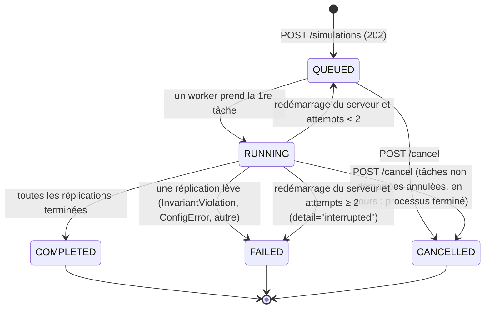

# 60 — Spécification de l'API (FastAPI, paquet `family_abm_api`)

> **Statut :** normatif pour la piste B. Dépend de `00`–`04`. Les noms de tables et colonnes sont ceux de `04_DATA_MODEL.md` ; aucun n'est redéfini ici.

---

## 0. Condition d'entrée

La piste B démarre quand la **porte V1 est verte** (`docs/GATES.md`) : les schémas de `04_DATA_MODEL.md` sont alors stables. Les routes qui exposent des colonnes V2/V3 renvoient ces colonnes à `null` (et `available_since: "v2"|"v3"` dans les métadonnées de réponse) tant que le run a été produit par une version antérieure.

## 1. Architecture en couches

```
┌──────────────────────────────────────────────────────────────┐
│ web/ (React) — présentation uniquement                       │
└──────────────────────────┬───────────────────────────────────┘
                           │ HTTP/JSON (OpenAPI 3.1)
┌──────────────────────────▼───────────────────────────────────┐
│ routers/ — FastAPI : validation, sérialisation, erreurs      │
├──────────────────────────────────────────────────────────────┤
│ services/simulation_service.py — orchestration : jobs, cycle │
│ de vie des runs, cache. AUCUNE logique de modèle             │
├──────────────────────────────────────────────────────────────┤
│ services/results_service.py — lecture DuckDB des Parquet ;   │
│ appelle family_abm.analysis.* pour tout indicateur           │
├──────────────────────────────────────────────────────────────┤
│ family_abm (moteur Mesa) — strictement inchangé, appelé via  │
│ family_abm.api_entry.run_simulation(config_path|dict, out)   │
├──────────────────────────────────────────────────────────────┤
│ Stockage : experiments/results/ (Parquet, 04 §1)             │
│            + data/api/meta.sqlite (métadonnées jobs)         │
└──────────────────────────────────────────────────────────────┘
```

### Règles dures

| # | Règle | Vérification |
|---|---|---|
| A1 | **Aucune logique de modèle** dans `family_abm_api` (pas de calcul de besoin, d'allocation, de NTA, de règle de décision). | Revue + contrat import-linter : `family_abm_api` ne peut importer que `family_abm.api_entry`, `family_abm.config.loader`, `family_abm.config.schemas`, `family_abm.io.catalog`, `family_abm.analysis.indicators`, `family_abm.analysis.patterns`. |
| A2 | **Aucun calcul d'indicateur hors `family_abm/analysis/`.** L'API agrège au plus par sélection/filtre/pagination SQL ; toute moyenne, dispersion, écart en %, Gini, etc. est obtenue par appel à `analysis.indicators`. | Test `tests/api/test_no_formula.py` : grep des opérateurs d'agrégation (`AVG`, `STDDEV`, `quantile`, `mean(`) interdit dans `family_abm_api/` hors `services/results_service.py` lignes marquées `# selection-only`. |
| A3 | Le moteur reste exécutable **sans** l'API (S6). L'API ne modifie aucun fichier de `config/` ni de `src/family_abm/`. | Contrat C2 de `01_ARCHITECTURE.md` (sens inverse). |
| A4 | Une requête HTTP ne bloque **jamais** sur une simulation : `POST /simulations` → `202 Accepted`. | Test de latence < 200 ms. |
| A5 | Exécution **hors ligne** : aucun service externe (pas de Redis, Celery, Postgres, CDN). | Test de démarrage sans réseau. |

## 2. Structure de fichiers

```
src/family_abm_api/
├── __init__.py
├── main.py                    ← create_app(settings) ; montage routers ; handlers d'erreurs
├── settings.py                ← Pydantic Settings : results_dir, meta_db, max_workers, cache_dir
├── schemas/                   ← modèles Pydantic des DTO (§4) — source du contrat OpenAPI
│   ├── common.py              ← Problem (RFC 9457), Page[T], RunRef, Dispersion
│   ├── simulations.py
│   ├── results.py
│   ├── scenarios.py
│   └── comparisons.py
├── routers/
│   ├── simulations.py         ← POST/GET /simulations, /{id}, /{id}/cancel
│   ├── results.py             ← /{id}/results, /{id}/indicators, /{id}/households/{hid}, /{id}/agents/{aid}
│   ├── scenarios.py
│   ├── comparisons.py
│   └── validation.py          ← écart assumé E-3
├── services/
│   ├── simulation_service.py  ← file de jobs, cycle de vie, reprise
│   ├── worker.py              ← fonction exécutée dans le processus fils (appelle le moteur)
│   ├── results_service.py     ← DuckDB, pagination, cache
│   └── repository.py          ← SQLModel / SQLite : SimulationJob, RunRecord
└── openapi_export.py          ← écrit web/src/api/openapi.json (CI)
tests/api/
├── conftest.py                ← app sur répertoire temporaire, mini-run V1 réel (1 foyer, 24 pas)
├── test_simulations.py  test_results.py  test_comparisons.py
├── test_job_lifecycle.py      ← annulation, reprise au redémarrage
├── test_contract.py           ← schéma OpenAPI figé (snapshot) + schemathesis
└── test_no_formula.py
```

## 3. Modèle de métadonnées (SQLite, `repository.py`)

```python
class JobStatus(StrEnum):
    QUEUED = "queued"; RUNNING = "running"; COMPLETED = "completed"
    FAILED = "failed"; CANCELLED = "cancelled"

class SimulationJob(SQLModel, table=True):
    simulation_id: str = Field(primary_key=True)     # "sim_" + ULID
    created_at: datetime
    started_at: datetime | None
    finished_at: datetime | None
    status: JobStatus
    attempts: int = 0                                 # reprises au redémarrage (≤ 2)
    request_json: str                                 # SimulationCreate sérialisé
    config_hash: str                                  # empreinte de la config résolue (sans le seed)
    progress_runs_done: int = 0
    progress_runs_total: int
    error_json: str | None                            # Problem détaillé (ex. InvariantViolation)
    illustrative: bool

class RunRecord(SQLModel, table=True):               # miroir de runs/run_id=…/run.json (04 §2.1)
    run_id: str = Field(primary_key=True)
    simulation_id: str = Field(foreign_key="simulationjob.simulation_id", index=True)
    seed: int
    status: str                                       # completed | failed (valeurs de 04 §2.1)
    duration_s: float | None
```

Une **simulation** (job) = 1 à R réplications (seeds) d'une même configuration ; chaque réplication est un **run** au sens de `04_DATA_MODEL` (`run_id`, un répertoire). La source de vérité des résultats reste `run.json` + Parquet ; SQLite n'est qu'un index (reconstructible par `python -m family_abm_api reindex`).

## 4. Endpoints

### 4.0 Conventions

- Préfixe `/api/v1`. JSON UTF-8. Nombres monétaires en FCFA (`float`), jamais formatés.
- Erreurs au format **Problem Details (RFC 9457)** :

```python
class Problem(BaseModel):
    type: str          # URI, ex. "https://family-abm/errors/invariant-violation"
    title: str
    status: int
    detail: str
    instance: str | None = None
    extra: dict[str, Any] = {}     # ex. {"step": 47, "account": "HOUSEHOLD_POT:h0003", "residual": 300.0}
```

- Pagination par **curseur** opaque (base64 de `(step, entity_id)`), `limit` ≤ 5 000, défaut 1 000 :

```python
T = TypeVar("T")
class Page(BaseModel, Generic[T]):
    items: list[T]
    next_cursor: str | None
    total_estimate: int | None

class Dispersion(BaseModel):       # rendu de analysis.indicators — jamais calculé ici
    mean: float; sd: float | None; q05: float | None; q95: float | None; n: int
```

| Code | Usage |
|---|---|
| 400 | paramètre invalide (table inconnue, colonne inconnue) |
| 404 | simulation / run / foyer / agent inconnu |
| 409 | résultats demandés alors que le job n'est pas `completed` (`extra.status`) |
| 422 | corps invalide (validation Pydantic, bornes du `SimulationCreate`) |
| 503 | file pleine (`max_queued` atteint) |

### 4.1 `POST /simulations` — créer une simulation

```python
class SimulationCreate(BaseModel):
    model_config = ConfigDict(extra="forbid")
    scenario_id: str                                     # doit exister dans config/scenarios
    model_version: Literal["v1", "v2", "v3"] = "v2"
    horizon_months: Literal[120, 240] | Annotated[int, Field(ge=12, le=960)] = 240
    n_households: Annotated[int, Field(ge=1, le=5000)] = 1
    seeds: Annotated[list[int], Field(min_length=1, max_length=200)] | None = None
    replications: Annotated[int, Field(ge=1, le=200)] | None = None   # seeds = seed_start..+n
    seed_start: int = 1000
    experiment_id: str | None = None                     # si fourni : le plan de config/experiments/<id>.yaml
    label: str | None = Field(default=None, max_length=120)

    @model_validator(mode="after")
    def _one_of_seeds(self): ...   # exactement un de seeds / replications (défaut : replications=1)

class SimulationAccepted(BaseModel):
    simulation_id: str
    status: JobStatus                                    # "queued"
    runs_total: int
    links: dict[str, str]                                # {"self": "/api/v1/simulations/sim_…"}
```

**Pas de surcharge libre de paramètres** : seuls les champs ci-dessus sont acceptés (`extra="forbid"`). Les variations de paramètres passent par un scénario ou une expérience versionnés dans `config/` (règle « pas d'édition de configuration via l'API »).

Réponse `202` + en-tête `Location`. Erreurs : 404 `scenario_id`/`experiment_id` inconnu, 422, 503.

```json
POST /api/v1/simulations
{"scenario_id": "job_loss", "model_version": "v2", "replications": 20}
→ 202
{"simulation_id": "sim_01JB8Z3QK7", "status": "queued", "runs_total": 20,
 "links": {"self": "/api/v1/simulations/sim_01JB8Z3QK7"}}
```

### 4.2 `GET /simulations/{id}` — statut

```python
class SimulationStatus(BaseModel):
    simulation_id: str
    status: JobStatus
    label: str | None
    request: SimulationCreate
    created_at: datetime; started_at: datetime | None; finished_at: datetime | None
    progress: float                                      # runs_done / runs_total
    runs: list[RunRef]
    illustrative: bool                                   # ≥ 1 PLACEHOLDER dans la config (03 §0)
    data_source: Literal["synthetic", "nta_profiles", "ehcvm"]
    config_hash: str
    engine_version: str
    error: Problem | None                                # si failed

class RunRef(BaseModel):
    run_id: str; seed: int; status: Literal["completed", "failed"] | None; duration_s: float | None
```

```json
{"simulation_id": "sim_01JB8Z3QK7", "status": "failed", "progress": 0.35,
 "illustrative": true, "data_source": "synthetic",
 "error": {"type": "https://family-abm/errors/invariant-violation",
           "title": "Violation d'invariant comptable", "status": 500,
           "detail": "Identité NTA non bouclée pour h0001-p2",
           "extra": {"run_id": "01JB8Z…", "step": 47, "account": "HOUSEHOLD_POT:h0001", "residual": 300.0}}}
```

### 4.3 `GET /simulations/{id}/results` — séries temporelles paginées

Paramètres de requête :

| Paramètre | Type | Défaut | Description |
|---|---|---|---|
| `table` | enum | — (requis) | `person_steps`, `household_steps`, `demands`, `events`, `decisions`, `nta_person_steps`, `nta_transfer_matrix`, `nta_age_profile`, `metrics`, `ledger` |
| `run_id` | str | première réplication | |
| `household_id`, `person_id` | str | — | filtres d'égalité |
| `step_from`, `step_to` | int | — | bornes incluses (`year_*` pour `nta_transfer_matrix`) |
| `columns` | liste séparée par virgules | toutes | doit être ⊆ colonnes du schéma Arrow de la table (sinon 400) |
| `every` | int ≥ 1 | 1 | **sous-échantillonnage** (un pas sur n) — sélection, pas agrégation |
| `age_bins` | liste d'entiers croissants (bornes inférieures, ex. `0,15,25,45,65`) | — | **uniquement pour `table=nta_age_profile` et `nta_transfer_matrix`** : regroupement par classes d'âge effectué par `family_abm.analysis.indicators.age_bins` (jamais par l'API ni le client) ; sert les flèches de Lee (70 §E) ; 400 pour une autre table |
| `cursor`, `limit` | | | pagination |

Réponse : `Page[dict[str, Any]]` en **format colonnes-compact** optionnel (`?format=columnar` → `{"columns": [...], "data": [[...]]}`) pour réduire le volume.

Erreurs : 404, 409 (non `completed`), 400 (`table`/`columns`).

### 4.4 `GET /simulations/{id}/indicators` — indicateurs agrégés

Délègue à `family_abm.analysis.indicators.summarize(run_dirs, scope, metrics)` ; met en cache le résultat (§6).

```python
class IndicatorValue(BaseModel):
    metric: str                     # nom exact de 04 §3 (ex. "debt_to_income", "gini_income")
    label_fr: str                   # libellé de 04 §3
    unit: str
    direction: Literal["lower_is_better", "higher_is_better", "neutral"]   # copié de analysis.indicators.CATALOG
    scope: Literal["household", "population"]
    household_id: str | None
    value: Dispersion               # sur les réplications (n = nb de runs)
    sparkline: list[float] | None   # série par pas (moyenne sur réplications) fournie par analysis
    delta: float | None             # variation sur les 12 derniers mois, fournie par analysis

class IndicatorsResponse(BaseModel):
    simulation_id: str
    as_of_step: int
    indicators: list[IndicatorValue]
```

Paramètres : `scope` (défaut `population` si `n_households > 1`), `household_id`, `metrics` (liste), `step` (pour le curseur de la frise : valeurs à ce pas).

### 4.5 `GET /simulations/{id}/households/{hid}` — détail d'un foyer

```python
class HouseholdDetail(BaseModel):
    household_id: str
    run_id: str
    members: list[MemberSummary]
    last_state: dict[str, Any]                 # ligne household_steps au pas demandé (défaut : dernier)
    transfers_year: list[TransferEdge]         # nta_transfer_matrix pour l'année du pas
    demands_step: list[dict[str, Any]]         # lignes demands du pas (bandeau de demandes)
    events: list[dict[str, Any]]               # events du foyer (fenêtre ±12 mois autour du pas)

class MemberSummary(BaseModel):
    person_id: str; role: str; profile_key: str; age_years: float; in_household: bool

class TransferEdge(BaseModel):
    src_person: str; dst_person: str; amount: float          # annuel, FCFA
```

Paramètres : `run_id`, `step`. Pas de pagination (volume borné).

### 4.6 `GET /simulations/{id}/agents/{aid}` — détail d'un agent

```python
class AgentDetail(BaseModel):
    person_id: str; household_id: str; role: str; run_id: str
    series: dict[str, list[float | int | str | None]]   # colonnes demandées de person_steps (+ "step")
    nta: dict[str, list[float]]                          # colonnes de nta_person_steps
    decisions: Page[dict[str, Any]]                      # table decisions (traces), tri step desc
    decisions_available: bool                            # False si foyer non échantillonné (output.collect.decisions)
```

Paramètres : `run_id`, `columns`, `step_from`, `step_to`, `cursor`, `limit` (sur les décisions).

### 4.7 `GET /scenarios` — scénarios disponibles

```python
class ScenarioInfo(BaseModel):
    id: str; label: str; description: str
    events: list[dict[str, Any]]           # tels que dans config/scenarios/<id>.yaml
    overrides: dict[str, Any]
class ExperimentInfo(BaseModel):
    id: str; title: str; hypothesis: str; factors: dict[str, list[Any]]; replications: int
class ScenariosResponse(BaseModel):
    scenarios: list[ScenarioInfo]
    experiments: list[ExperimentInfo]      # lecture de config/experiments — lecture seule
```

### 4.8 `POST /comparisons` — comparer des simulations

```python
class ComparisonCreate(BaseModel):
    model_config = ConfigDict(extra="forbid")
    simulation_ids: Annotated[list[str], Field(min_length=2, max_length=6)]
    baseline_id: str                                  # ∈ simulation_ids
    metrics: Annotated[list[str], Field(min_length=1, max_length=12)]
    series_metric: str | None = None                  # série pour les petits multiples

class ComparisonCell(BaseModel):
    simulation_id: str
    value: Dispersion
    pct_vs_baseline: float | None                     # fourni par analysis.indicators.compare
class ComparisonRow(BaseModel):
    metric: str; label_fr: str; unit: str
    direction: Literal["lower_is_better", "higher_is_better", "neutral"]   # copié de CATALOG (sert la couleur de variation, 70 §F)
    cells: list[ComparisonCell]
class ComparisonResponse(BaseModel):
    rows: list[ComparisonRow]
    series: dict[str, SeriesBand] | None              # par simulation, mêmes pas
    shared_domain: dict[str, tuple[float, float]]     # domaines communs (échelles fixes, UX §F)
class SeriesBand(BaseModel):
    step: list[int]; mean: list[float]; q05: list[float]; q95: list[float]
```

Synchrone (lecture de résultats existants, calcul délégué à `analysis.indicators.compare`, mis en cache). 409 si une simulation n'est pas `completed` ; 422 si `baseline_id ∉ simulation_ids` ou métrique inconnue.

### 4.9 Écarts assumés aux « huit endpoints » (justifiés par l'UX)

| # | Route | Justification | Alternative écartée |
|---|---|---|---|
| E-1 | `GET /simulations` (liste paginée, filtres `status`, `scenario_id`) | Écrans Dashboard, Scénarios, Comparaison : il faut choisir une simulation existante. | Stocker les ids côté navigateur : perdus au changement de poste, non partageables. |
| E-2 | `POST /simulations/{id}/cancel` | Annulation d'un job long (file à 1 000 foyers × 100 réplications). | Aucune : sans elle un job erroné occupe le worker pendant des heures. |
| E-3 | `GET /validation` (patterns, indices de sensibilité, critères des portes) | Écran G : données non rattachées à une simulation (`pattern_results`, `sensitivity_indices`, `docs/GATES.md`). | Les détourner dans `/results` : mélangerait runs et études. |
| E-4 | `GET /health` | Vérification de démarrage hors ligne (test A5, démo). | — |

Total : 8 routes de la feuille de route + 4 écarts. Toute route supplémentaire exige une ligne dans ce tableau.

```python
class ValidationResponse(BaseModel):
    patterns: list[PatternResult]          # lignes pattern_results (04 §2.12) + role de config/patterns.yaml
    assignment_hash_ok: bool               # recalcul via family_abm.analysis.patterns
    sensitivity: list[dict[str, Any]]      # lignes sensitivity_indices (study_id le plus récent par défaut)
    gates: list[GateCriterion]
class PatternResult(BaseModel):
    pattern_id: str; name: str; level: str
    role: Literal["calibration", "validation", "exploratory"]
    simulated: Any; target: Any; distance: float | None; tolerance: float | None; pass_: bool | None = Field(alias="pass")
class GateCriterion(BaseModel):
    gate: Literal["V1", "V2", "V3"]; criterion: str; status: Literal["green", "red", "pending"]; evidence: str | None
```

Paramètres : `context_id` (calibration ou expérience), `study_id`.

### 4.10 Interdits

CRUD sur les agents · édition de configuration via l'API (aucun `PUT/PATCH` sur `config/`) · authentification multi-utilisateurs (un jeton statique optionnel `API_TOKEN` en en-tête suffit si exposé sur un réseau) · WebSocket / streaming pas à pas (l'UI interroge le statut toutes les 2 s tant que `queued|running`).

## 5. File de jobs

### 5.1 Mécanisme

- `SimulationService` possède un `concurrent.futures.ProcessPoolExecutor(max_workers=settings.max_workers)` (défaut : `os.cpu_count() − 1`, min 1) et une file FIFO en mémoire **reflétée dans SQLite** (`status=queued`).
- Une simulation de R réplications est découpée en R tâches `worker.run_one(request, seed, out_dir)` ; le job est `completed` quand toutes les tâches sont `completed`, `failed` dès qu'une tâche lève (les autres sont annulées si non démarrées ; les runs déjà finis sont conservés et listés).
- `worker.run_one` : charge la config via `family_abm.config.loader` (scénario + version + horizon + n_households + seed), appelle `family_abm.api_entry.run_simulation`, retourne `run.json`. **Aucune autre logique.**
- Une `InvariantViolation` est capturée, sérialisée en `Problem` (`type: invariant-violation`, `extra` : pas, compte, résidu) et rend le job `failed`. Elle n'est **jamais** convertie en avertissement.
- `max_queued` (défaut 50) → 503 au-delà.

### 5.2 Machine à états



### 5.3 Annulation et reprise

- **Annulation** : `future.cancel()` pour les tâches en attente ; pour une tâche en cours, le worker vérifie un drapeau fichier `out_dir/.cancel` tous les 12 pas via le crochet `on_year_end` exposé par `api_entry` (le moteur ne connaît pas l'API : le crochet est un simple callable optionnel). Répertoires de runs incomplets supprimés.
- **Reprise au démarrage** (`lifespan`) : tout job `running` repasse `queued` (attempts += 1) — les runs sont déterministes par seed, la ré-exécution donne le même résultat ; les runs dont `run.json` est `completed` ne sont pas relancés.

## 6. Cache

- Clé = `(simulation_id, endpoint, paramètres normalisés)` ; un job `completed` est immuable → cache sans expiration, invalidé seulement par `reindex`.
- Indicateurs et comparaisons : résultats de `analysis.*` écrits en Parquet sous `experiments/results/cache/<sha1(clé)>.parquet` ; réponses JSON légères en LRU mémoire (`functools.lru_cache`, 256 entrées).
- **Identité de configuration** : `POST /simulations` dont `(config_hash, seed)` correspond à un run `completed` existant réutilise ce run (lien symbolique dans le job) — `extra.reused_runs` dans la réponse de statut.

## 7. Lecture des résultats (DuckDB)

- `results_service` ouvre `catalog.duckdb` en **lecture seule** (`read_only=True`), une connexion par requête (thread-safe), vues créées par `family_abm.io.catalog` sur `read_parquet('…/run_id=*/<table>.parquet', hive_partitioning=true)`.
- Requêtes paramétrées uniquement (pas de concaténation) ; liste blanche des tables et colonnes dérivée des schémas Arrow de `io/parquet.py`.
- Pagination : `ORDER BY step, <clé>` + `WHERE (step, key) > (?, ?)`.

## 8. Contrat OpenAPI → TypeScript

- `python -m family_abm_api.openapi_export` écrit `web/src/api/openapi.json` ; `npx openapi-typescript web/src/api/openapi.json -o web/src/api/schema.d.ts`. Les deux fichiers sont commités.
- CI : régénération puis `git diff --exit-code` — un changement de DTO non répercuté dans le frontend fait échouer la CI.
- `operation_id` explicites (`createSimulation`, `getSimulation`, `listSimulations`, `getResults`, `getIndicators`, `getHousehold`, `getAgent`, `listScenarios`, `createComparison`, `cancelSimulation`, `getValidation`, `health`).
- Libellés FR des indicateurs (`label_fr`) viennent de `analysis.indicators.CATALOG` (une seule source, partagée avec 04 §3).

## 9. Tests

| Test | Contenu |
|---|---|
| `test_simulations.py` | 202 + Location ; 422 sur champ inconnu (`extra="forbid"`) ; 404 scénario inconnu ; 503 file pleine |
| `test_results.py` | pagination complète = table entière (concaténation des pages == lecture Parquet directe) ; 400 colonne inconnue ; 409 job non terminé ; `every` |
| `test_job_lifecycle.py` | annulation en file et en cours ; reprise après arrêt brutal (job `running` → `queued`, même résultat par seed) ; `InvariantViolation` injectée via un scénario de test → `failed` + `Problem` complet |
| `test_comparisons.py` | `pct_vs_baseline` identique à `analysis.indicators.compare` appelé directement |
| `test_contract.py` | snapshot du schéma OpenAPI ; `schemathesis` sur toutes les routes |
| `test_no_formula.py` | règle A2 |
| `test_offline.py` | démarrage et run complet avec réseau coupé (A5) |

Outils : `pytest`, `httpx.AsyncClient` + `ASGITransport`, `schemathesis`. Fixture : vrai moteur V1, 1 foyer, 24 pas (pas de mock du moteur — le contrat porte sur des données réelles).

## 10. Exécution locale

```bash
uv run python -m family_abm_api serve --results-dir experiments/results --workers 3
# = uvicorn family_abm_api.main:app --host 127.0.0.1 --port 8000  (un seul processus serveur)
uv run python -m family_abm_api reindex        # reconstruit SQLite depuis run.json
```

Swagger UI (`/docs`) suffit comme interface tant que le frontend n'existe pas (phase initiale). CORS limité à `http://localhost:5173` (Vite) par défaut.

## 11. Détails tranchés dans ce document

- Simulation = job regroupant 1–200 réplications ; un run par seed (compatible `04` §2.1).
- Préfixe `/api/v1` ; erreurs RFC 9457 ; pagination par curseur ; format colonnes optionnel ; paramètre `every`.
- Quatre écarts assumés : `GET /simulations`, `POST /simulations/{id}/cancel`, `GET /validation`, `GET /health`.
- Pas de surcharge libre de paramètres dans `POST /simulations` (scénario/expérience versionnés uniquement).
- Reprise automatique limitée à 2 tentatives ; réutilisation des runs de même `(config_hash, seed)`.
- `family_abm.api_entry.run_simulation(config, out_dir, on_year_end=None)` : unique point d'entrée du moteur exposé à l'API (à créer dans le moteur, sans dépendance web).
- `analysis.indicators` expose `CATALOG`, `summarize`, `compare` ; `sparkline` et `delta` sont produits par `analysis`, pas par l'API.
- Interrogation du statut par polling (2 s) faute de WebSocket.
